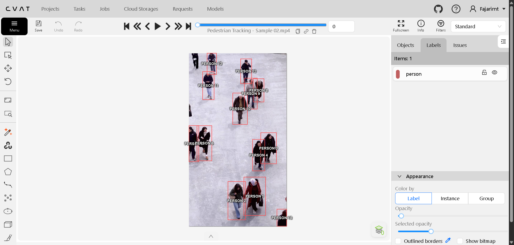
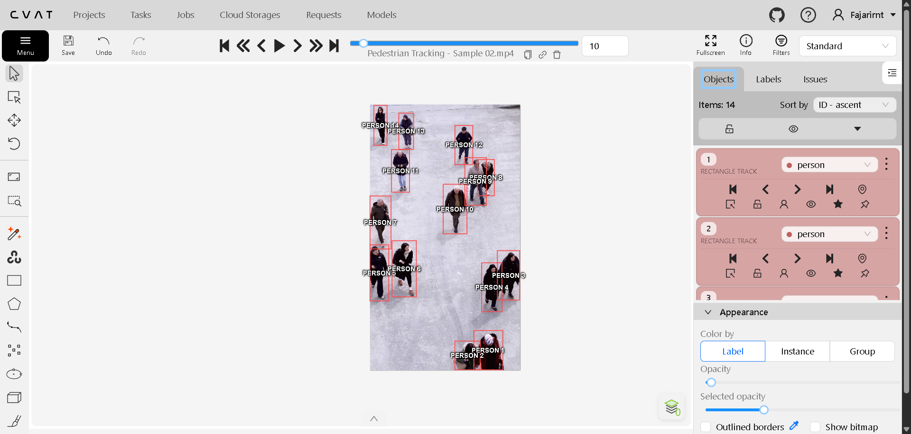
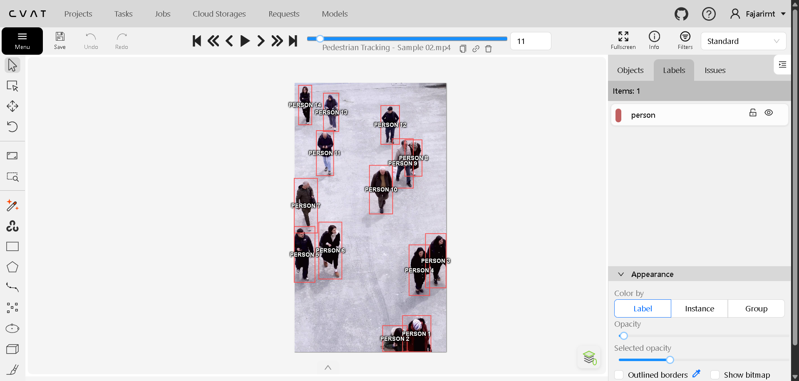
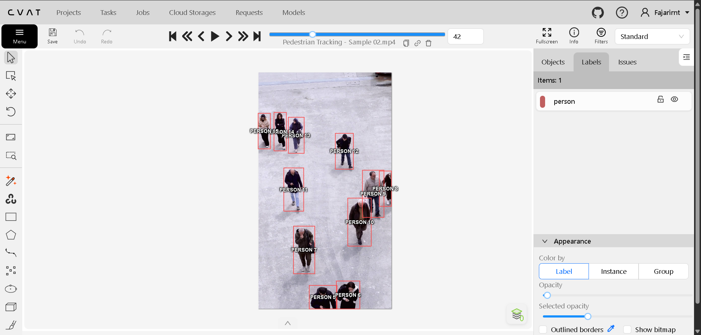
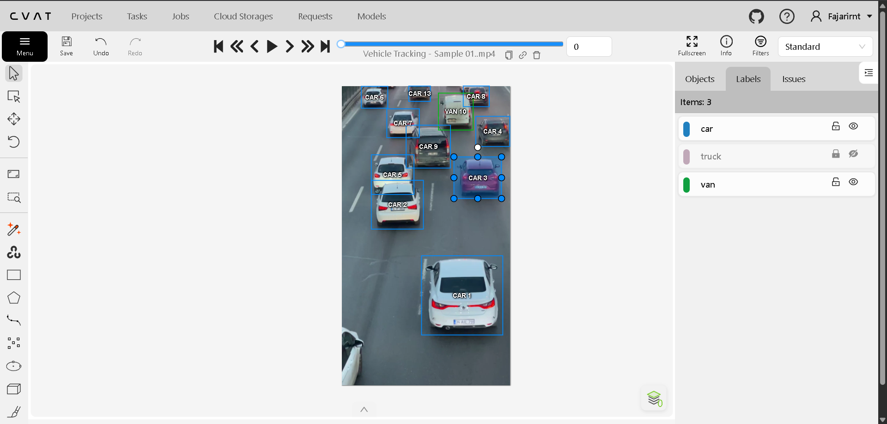
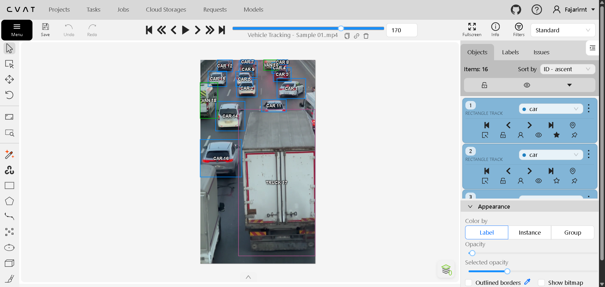
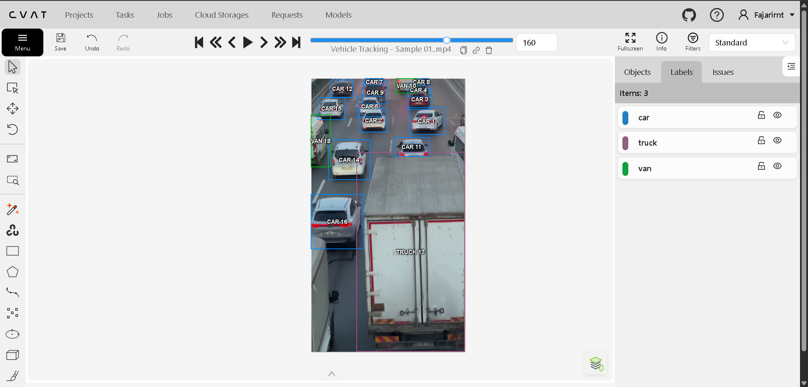
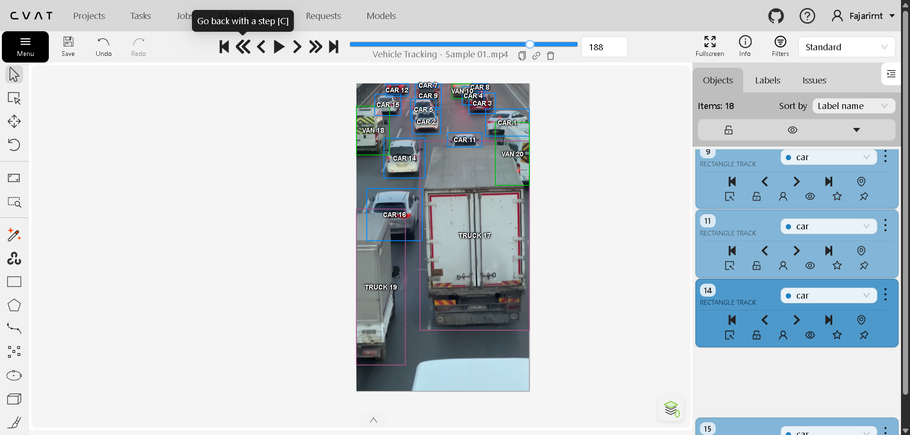

# Video Annotation Portfolio
### Pedestrian & Vehicle Tracking | CVAT

## Project Overview

This portfolio showcases my personal practice in video annotation and object tracking using CVAT (Computer Vision Annotation Tool).

The project focuses on bounding box annotation, tracking ID consistency, object visibility, occlusion handling, and annotation review across video frames.

## Tools & Skills

- CVAT (Computer Vision Annotation Tool)
- Video Object Annotation
- Bounding Box Annotation
- Pedestrian Tracking
- Vehicle Tracking
- Tracking ID Consistency
- Occlusion Handling
- Annotation Quality Review

---

## 1. Pedestrian Tracking

This sample demonstrates pedestrian annotation and tracking across video frames.

### Annotation Example

### Dataset Overview

### Tracking Across Frames

**Frame 11**

**Frame 42**

### Annotation Export

[Download Pedestrian Tracking Annotations (ZIP)](annotations/Pedestrian_Tracking_Sample_02.zip)

---

## 2. Vehicle Tracking

This sample demonstrates vehicle annotation and tracking in an urban street scene, including tracking consistency and partially occluded vehicles.

### Annotation Example

### Dataset Overview

### Tracking Across Frames

**Frame 160**

**Frame 188**

### Annotation Export

[Download Vehicle Tracking Annotations (ZIP)](annotations/Vehicle_tracking_sample_01.zip)

---

## Annotation Workflow

1. Prepare the video sample for annotation.
2. Configure object labels in CVAT.
3. Draw bounding boxes around target objects.
4. Assign and maintain tracking IDs across frames.
5. Review keyframes and interpolated annotations.
6. Handle partial occlusion and object visibility.
7. Review annotation consistency and export the results.

## Video Source

Vehicle tracking practice footage:

[Busy Street — Pexels](https://www.pexels.com/video/busy-street-1192116/)

The original footage belongs to its respective creator. Annotations are created separately for personal practice and portfolio demonstration.

## Project Type

Personal practice project. The samples demonstrate practical familiarity with video annotation, object tracking, and annotation review using CVAT.

## Related Portfolios

- [Main Profile Portfolio](https://github.com/FajarIrnt/Profile-Portfolio)
- [Image Annotation Portfolio](https://github.com/FajarIrnt/image-annotation-portfolio)
- [AI Speech Evaluation Portfolio](https://github.com/FajarIrnt/ai-speech-evaluation-portfolio)

## Author

**Fajar Irianto**

[GitHub Profile](https://github.com/FajarIrnt)
